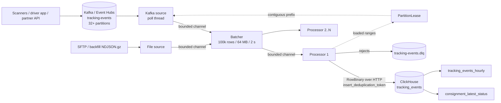

# EventingC3 ETL — Architecture

Loads RAM tracking events from Kafka / Azure Event Hubs (or NDJSON bulk files) into ClickHouse,
sized for **1 billion records per day** with headroom for worst-case peaks and outage catch-up.

## Design targets

| | Value | Basis |
|---|---|---|
| Average rate | 11,574 rec/s | 1,000,000,000 / 86,400 |
| Design peak | ~60,000 rec/s | 5× average (end-of-day POD bursts, partner batch drops) |
| Catch-up | drain a 6 h backlog (~250 M) in < 1 h while live traffic continues | ClickHouse or network outage |
| Raw ingress | ~320 GB/day (~320 B/record JSON) | measured from the load generator |
| Warehouse growth | ~40–60 B/row compressed ≈ 40–60 GB/day per replica | ZSTD + LowCardinality |
| Data loss | none: every record ends in the warehouse or the DLQ | at-least-once + idempotent load |
| Duplicates | collapse to one row | insert tokens + ReplacingMergeTree |

## Flow

Each worker is one .NET 10 process. Scale-out is by Kafka partition: run up to one worker per partition and
the consumer group (cooperative-sticky) spreads partitions across them. KEDA scales replicas on consumer lag.

### Stages

1. **Extract** — `KafkaRecordSource` runs librdkafka on a dedicated thread (the only thread that touches the
   consumer). Auto-commit is off. When the pipeline is full it *pauses* partitions but keeps polling, so a long
   ClickHouse outage never gets the worker evicted from the group. `FileRecordSource` streams `.ndjson[.gz]`
   files line by line with bounded line length.
2. **Batch** — `Batcher` cuts on rows, bytes or age. ClickHouse wants few, large inserts (each insert creates a
   part); 100k rows ≈ 15–30 MB RowBinary is the sweet spot. Low-volume periods still flush every 2 s.
3. **Transform** — `TrackingEventParser` is a single forward pass with `Utf8JsonReader` (no DOM):
   validation, normalisation (upper-case codes, alias event types, any timestamp format → UTC with SAST as
   the default zone), enrichment (hub → region), deterministic UUIDv5 ids for id-less events, and schema-drift
   capture (unknown fields become attributes instead of being dropped). Any byte sequence produces an event
   or a reject reason — it never throws.
4. **Load** — rows are encoded straight into pooled buffers as ClickHouse `RowBinary` (no text parsing on the
   server) and POSTed as one atomic insert per batch.
5. **Commit** — `PartitionLease` tracks each partition's in-flight ranges and only advances the commit point over
   a fully loaded prefix, so out-of-order batch completion can never commit past an unloaded record.

## Worst-case behaviour

| Scenario | Behaviour | Verified by |
|---|---|---|
| Malformed / invalid records | Dead-lettered with reason, original bytes and source position; never blocks the partition | unit + `Streams_a_topic_into_clickhouse_exactly` |
| A row ClickHouse refuses despite validation | Batch is bisected (O(k log n) inserts) to isolate and dead-letter only the bad rows | `Bisects_to_isolate_rows_the_warehouse_refuses` |
| ClickHouse down / overloaded / `TOO_MANY_PARTS` | Retry forever with jittered exponential back-off (cap 30 s); back-pressure pauses the consumer; nothing is committed; `/readyz` goes unhealthy | `Rides_out_a_clickhouse_outage` (connections cut mid-insert) |
| Insert timed out but actually succeeded | Retried with the same `insert_deduplication_token` → server ignores the repeat (MV targets too) | `Retried_insert_with_the_same_token_is_written_once` |
| Worker crash (no graceful shutdown) | Replays from last committed offset; ReplacingMergeTree collapses re-inserted rows | `Survives_a_worker_crash_without_loss_or_duplicates` |
| Rebalance / scale in / scale out | Revoked partitions commit what is loaded, skip the rest; the new owner resumes from the commit | `Rebalances_across_workers_without_loss` (10/10 + soak) |
| Producer retries (duplicate messages) | Dropped in-batch by event id; across batches collapsed by ReplacingMergeTree | unit + e2e |
| Producer omits event id | UUIDv5 from (waybill, type, time, hub, courier) so re-sends still deduplicate | `Derives_a_stable_id_when_the_producer_omits_it` |
| DLQ unavailable | Retried; the batch is not committed until its rejects are acknowledged (`acks=all`, idempotent producer) | `Retries_dead_letter_publishing_before_committing` |
| Oversized messages | Rejected before parsing (64 KB); DLQ payload truncated to stay under broker limits | unit |
| Clock skew / late data | Accepted within `MaxEventAge` (30 d) / `MaxFutureSkew` (1 h); raise `MaxEventAge` for backfills | unit |
| Bug in a stage | Pipeline fails fast, `/healthz` 503, container restarts; uncommitted work replays | `A_faulting_stage_fails_the_pipeline_instead_of_hanging` |

### Two bugs the integration tests caught

* **Silent loss on rebalance.** The first insert token hashed only source offset ranges. Kafka returns large
  single-partition chunks, so two workers could build batches over the *same* offset range. If the old owner
  lost the partition mid-batch it inserted only part of the range, and ClickHouse then discarded the new
  owner's complete insert as a "duplicate". The token now hashes the exact event ids in each insert.
* **Double-counted rollups.** ClickHouse only deduplicates materialized-view writes when the MV *target* table
  has its own `non_replicated_deduplication_window`; without it the hourly counts doubled on retried inserts.

## Delivery semantics

At-least-once delivery with idempotent loading:

* Same insert retried → same token → applied once (immediately).
* Same records re-read after a crash/rebalance → new token → duplicate rows that ReplacingMergeTree collapses
  on merge. Queries needing exact counts use `FINAL` (or `argMax`/`uniqExact(event_id)`); dashboards can use
  the hourly rollup, which can over-count only by those replayed rows.

## ClickHouse schema (`deploy/clickhouse/001_schema.sql`)

* `tracking_events` — `ReplacingMergeTree(ingested_at)`, `PARTITION BY toYYYYMM(occurred_at)`,
  `ORDER BY (waybill, occurred_at, event_id)`; bloom-filter skip indexes on `event_id` and `courier_id`.
  Monthly partitions keep part counts sane at ~30 B rows/month.
* `consignment_latest_status` — latest event per waybill (the "where is my parcel" lookup), via MV.
* `tracking_events_hourly` — per hour / event type / region counts, via MV.
* Production: `ReplicatedReplacingMergeTree` with a `Distributed` table sharded by `cityHash64(waybill)`,
  `insert_quorum=2`. Add a `TTL` if raw events have a retention limit.

## Capacity & sizing

Measured on a 4-vCPU sandbox (ClickHouse, Redpanda, load generator and worker all on the same box): see
`README.md` → *Benchmark results*. Production guidance:

| Component | Recommendation |
|---|---|
| Event Hubs | Premium (≈ 4–8 PUs) or Dedicated, ≥ 32 partitions. Standard is not enough: a TU is 1 MB/s **or 1,000 events/s**, so 1B/day needs ~12 TU on average and ~60 at peak, above Standard's 40-TU ceiling |
| ETL workers | 2–4 × 2 vCPU / 4 GiB on AKS, KEDA min 2 (availability), max = partition count |
| ClickHouse | 2 replicas × (16 vCPU, 64 GiB, premium SSD); ~20 TB/year/replica before TTL |

## Operations

* **Metrics** — `/metrics` (Prometheus): records read/loaded/rejected (by reason)/duplicates, batches, insert
  latency, retries, bisections, back-pressure events, in-flight batches, last successful load time.
  Alert on: consumer lag (KEDA/Event Hubs), `etl_sink_retries_total` rate, `etl_records_rejected_total` rate,
  `time() - etl_last_load_timestamp_seconds > 300`.
* **Health** — `/healthz` (liveness: pipeline not faulted), `/readyz` (warehouse accepting inserts).
* **DLQ replay** — dead letters keep the original bytes plus `dlq.reason`, `dlq.source`, `dlq.partition`,
  `dlq.offset` headers. Fix the producer or the rule, then re-publish the payloads to `tracking-events`.
* **Backfill** — run the worker with `Etl__Source=File`, `Etl__Files__StopWhenIdle=true` and a larger
  `Etl__Transform__MaxEventAge`; it exits when the inbox is empty and moves completed files to `processed/`.
